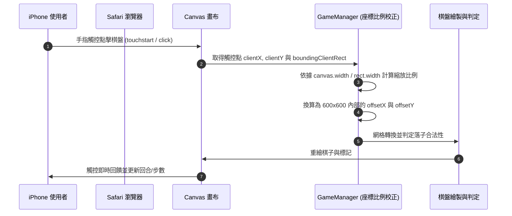
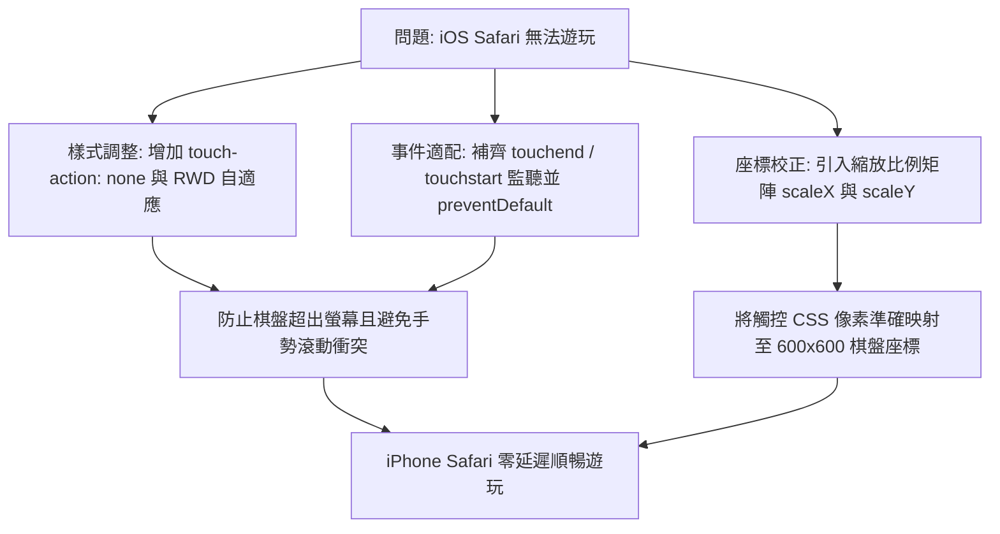

# 行動端與 iOS Safari 觸控適配實作計畫書

## 1. 前提是什麼
- **系統環境**：支援跨平台（iOS Safari、Android Chrome、macOS/Windows 等各式瀏覽器），純前端靜態單頁應用 (SPA)。
- **裝置差異**：行動裝置（如 iPhone）主要仰賴觸控螢幕手勢（`touchstart` / `touchend`），螢幕寬度通常介於 375px 至 430px，遠小於桌機版 600px 寬度。
- **限制條件**：必須在維持原樣式設計（Minimalist Light Mode）及原有遊戲核心邏輯的前提下，無痛擴充行動端適配。

## 2. 目的是什麼
- 讓五子棋遊戲在 iPhone Safari 及各式行動裝置上均能正常縮放與流暢觸控落子。
- 支援響應式 RWD 棋盤佈局，防止 Canvas 超出螢幕寬度。
- 支援觸控事件並校正 CSS 縮放後的精確網格座標換算，防止手勢滾動衝突。

## 3. 流程是什麼

## 4. 問題有哪些
- **事件攔截與延遲**：iOS Safari 對 Canvas 的 click 事件可能產生 300ms 延遲或被雙擊縮放、滑動手勢攔截。
- **座標偏移變形**：當 Canvas 寬度自適應螢幕寬度（例如縮小為 340px）時，若直接拿觸控像素當作內部 600px 像素計算，會導致落子位置嚴重偏移甚至無法判定。
- **頁面跟隨滑動**：手指在棋盤上滑動時容易帶動整頁上下滾動。

## 5. 問題怎麼解決

## 6. 測試方法
- **Chrome 開發者工具行動端模擬**：使用 Responsive Mode 模擬 iPhone 12 / 14 / SE 尺寸，驗證觸控點擊落子精準度。
- **實機 iPhone Safari 驗證**：在 Safari 中直接開啟檔案，驗證：
  1. 棋盤完整置中且不被截斷。
  2. 手指輕觸能立即精準落子。
  3. 電腦 AI 正常回應。
  4. 悔棋與彈窗操作正常。

## 7. 完成後怎麼使用
- 在 iPhone 上直接使用 Safari 開啟 `fivechess_standalone.html`（或透過 AirDrop / 網頁伺服器開啟），即可單手觸控暢玩。

### 架構適配心智圖 (Inline SVG)
<svg xmlns="http://www.w3.org/2000/svg" viewBox="0 0 760 300" width="100%" height="300">
  <defs>
    <filter id="shadow2" x="-5%" y="-5%" width="110%" height="110%">
      <feDropShadow dx="2" dy="2" stdDeviation="3" flood-opacity="0.1"/>
    </filter>
  </defs>
  <!-- 背景 -->
  <rect width="100%" height="100%" fill="#f8fafc" rx="8"/>
  
  <!-- 核心節點 -->
  <rect x="30" y="120" width="180" height="60" rx="8" fill="#2563eb" filter="url(#shadow2)"/>
  <text x="120" y="155" fill="#ffffff" font-size="16" font-weight="bold" text-anchor="middle" font-family="sans-serif">行動端與 iOS Safari 適配</text>

  <!-- 連線 -->
  <path d="M 210 150 C 270 150, 270 50, 330 50" stroke="#94a3b8" stroke-width="2" fill="none"/>
  <path d="M 210 150 C 270 150, 270 150, 330 150" stroke="#94a3b8" stroke-width="2" fill="none"/>
  <path d="M 210 150 C 270 150, 270 250, 330 250" stroke="#94a3b8" stroke-width="2" fill="none"/>

  <!-- 分支 1: CSS 樣式 -->
  <rect x="330" y="25" width="160" height="50" rx="6" fill="#ffffff" stroke="#cbd5e1" stroke-width="1.5" filter="url(#shadow2)"/>
  <text x="410" y="55" fill="#0f172a" font-size="14" font-weight="600" text-anchor="middle" font-family="sans-serif">CSS RWD & 觸控約束</text>

  <!-- 分支 2: 座標轉換 -->
  <rect x="330" y="125" width="160" height="50" rx="6" fill="#ffffff" stroke="#cbd5e1" stroke-width="1.5" filter="url(#shadow2)"/>
  <text x="410" y="155" fill="#0f172a" font-size="14" font-weight="600" text-anchor="middle" font-family="sans-serif">動態座標換算</text>

  <!-- 分支 3: 事件支援 -->
  <rect x="330" y="225" width="160" height="50" rx="6" fill="#ffffff" stroke="#cbd5e1" stroke-width="1.5" filter="url(#shadow2)"/>
  <text x="410" y="255" fill="#0f172a" font-size="14" font-weight="600" text-anchor="middle" font-family="sans-serif">觸控手勢監聽</text>

  <!-- 細項連線 -->
  <path d="M 490 50 L 540 50" stroke="#cbd5e1" stroke-width="1.5" fill="none"/>
  <path d="M 490 150 L 540 150" stroke="#cbd5e1" stroke-width="1.5" fill="none"/>
  <path d="M 490 250 L 540 250" stroke="#cbd5e1" stroke-width="1.5" fill="none"/>

  <!-- 子節點標籤 -->
  <text x="550" y="55" fill="#64748b" font-size="13" font-family="sans-serif">max-width: 100%, touch-action: none</text>
  <text x="550" y="155" fill="#64748b" font-size="13" font-family="sans-serif">scaleX / scaleY 補償</text>
  <text x="550" y="255" fill="#64748b" font-size="13" font-family="sans-serif">touchstart / touchend 防衝突</text>
</svg>

## 8. 程式碼異動明細與變更理由
- `[MODIFY] css/style.css`:
  - **具體內容**：設定 `#chessBoard` 為 `max-width: 100%; height: auto; touch-action: none;`，並於行動裝置小螢幕（max-width: 640px）加入控制面板排版微調。
  - **變更理由**：防止棋盤破版超出螢幕，並阻斷瀏覽器預設滑動干擾。
- `[MODIFY] js/game.js`:
  - **具體內容**：於 `GameManager` 新增精確座標換算邏輯（乘上 `scaleX` 與 `scaleY`），並同時綁定 `touchend` 觸控事件以支援手機點擊。
  - **變更理由**：解決在 RWD 縮小顯示下落子座標偏差與點擊無反應問題。
- `[MODIFY] fivechess_standalone.html`:
  - **具體內容**：同步將上述 CSS 與 JS 修正整合至單一獨立 HTML 檔案中。
  - **變更理由**：確保獨立單檔在任何行動裝置中雙擊或開啟皆可直接遊玩。
